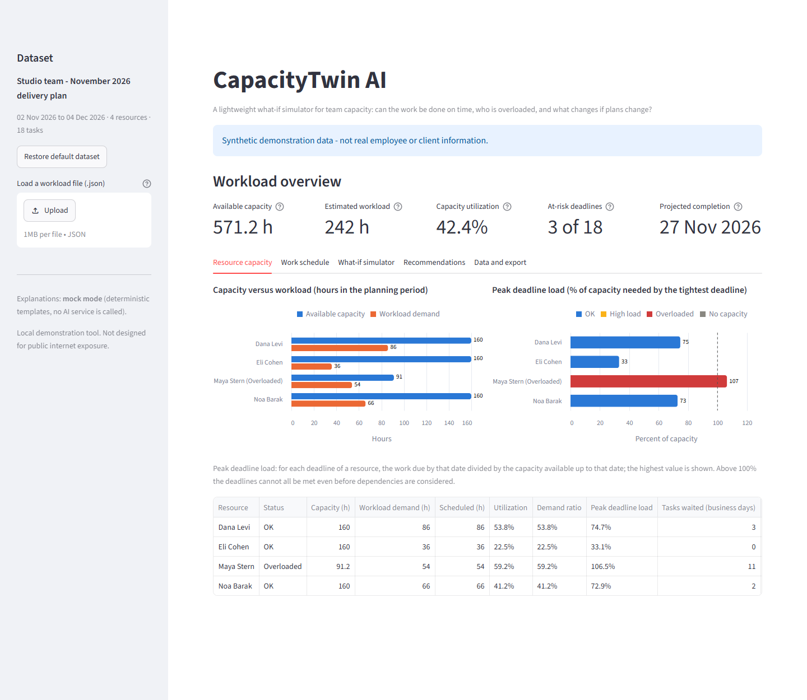
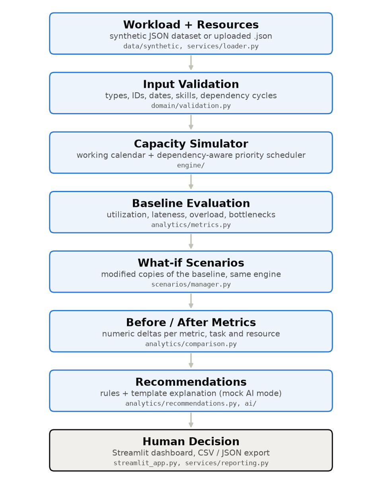

# CapacityTwin AI

A lightweight what-if simulator that shows whether a small team can deliver its workload on time, who is overloaded, and what changes when plans change.

> Synthetic demonstration data only. Results are estimates from a simplified model, not predictions.

## What?

CapacityTwin AI is a small operational "digital twin" of a team's workload. You give it people (working hours, skills, days off) and tasks (effort, priority, deadline, dependencies). It builds a day-by-day schedule and reports:

- available capacity, estimated workload and utilization, per person and in total
- projected completion date of every task, and which deadlines are missed and by how many business days
- who is overloaded, who is the bottleneck, and which prerequisite is holding a task up
- how all of that changes under a what-if scenario, as plain numerical before/after differences

## Why?

A task list shows what must be done, not whether it is achievable. Freelancers, team leads and small-business owners commit to dates by gut feeling, and discover the conflict when a deadline slips. Total hours rarely tell the story: in the demo data the team uses only 42% of its capacity, yet three deadlines are missed because everything queues behind one part-time designer.

## How?

1. Load the built-in synthetic workload (one click) or your own JSON file.
2. The simulator validates the input and schedules the work with a fixed, documented rule set.
3. Review the baseline: capacity, schedule, late tasks and their causes.
4. Pick a what-if scenario (extra work, someone away, extra hours, changed deadline or priority, reassignment) and press **Run simulation**.
5. Compare before and after, read the recommendations, and decide. The tool never acts on its own.

## Visual Overview



More: [work schedule](assets/screenshots/work-schedule.png) · [before/after comparison](assets/screenshots/what-if-comparison.png)



## Quick Start

Requires Docker with Compose.

```bash
docker compose up --build
```

Open <http://localhost:8501>. Stop with:

```bash
docker compose down
```

Without Docker (Python 3.12):

```bash
pip install -r requirements.txt
streamlit run app/streamlit_app.py
```

## Demo

A two-minute walkthrough with the built-in data (full version in [docs/demo.md](docs/demo.md)):

| Plan | Capacity | Missed deadlines | Total lateness | Last task finishes |
| --- | --- | --- | --- | --- |
| Baseline | 571.2 h | 3 of 18 | 5 business days | 27 Nov |
| Developer works +2 h/day | 611.2 h | 3 | 5 business days | 27 Nov |
| Designer works +2 h/day | 601.6 h | 0 | 0 | 25 Nov |

Forty extra developer hours change nothing; thirty extra designer hours fix every deadline. The simulator models constraints instead of assuming more hours always help.

## Engineering Approach

- **Python 3.12, modular OOP**: typed dataclasses; the engine has no UI or framework dependency.
- **Deterministic simulation**: a dependency-aware priority scheduler in whole minutes. Same input, same output, same run ID.
- **Streamlit** dashboard with Altair charts; presentation only.
- **Optional AI, mock by default**: explanations are deterministic templates over engine output. No API key, no network. A real LLM provider is a documented extension point, not implemented.
- **Docker**: one container, non-root, read-only filesystem, health check, bound to localhost.
- **Shift-left QA and security**: 149 automated tests (unit, integration, end-to-end), strict input validation, safe exports, dependency audit.

Three runtime dependencies: `streamlit`, `pandas`, `altair`.

## Limitations

The model is deliberately simple: fixed effort estimates, one task per person at a time, no interruptions or hand-overs, a greedy (not optimal) scheduler, no uncertainty modelling. It is decision support for planning conversations. It must not be used for performance, disciplinary or employment decisions, and it is not built for public internet exposure. See [docs/limitations.md](docs/limitations.md).

## Documentation

- [Architecture](docs/architecture.md)
- [Simulation methodology](docs/simulation-methodology.md)
- [Demo](docs/demo.md)
- [Testing](docs/testing.md)
- [Assurance: security, observability, AI boundaries, privacy](docs/assurance.md)
- [Limitations and future work](docs/limitations.md)
