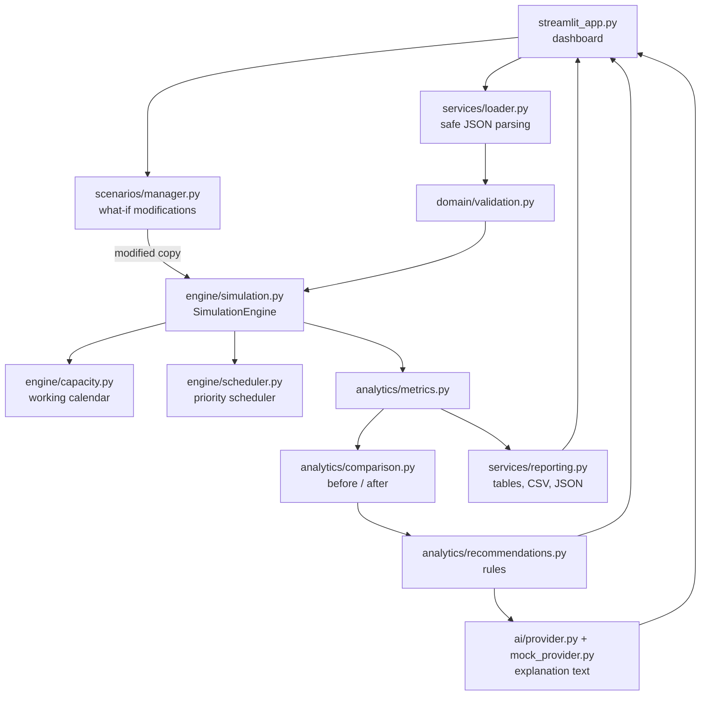

# Architecture

One Python process, one container, no database. State lives in the browser session.

The same flow as a picture: [`assets/architecture-diagram.png`](../assets/architecture-diagram.png).

## Components

| Module | Responsibility |
| --- | --- |
| `app/domain/models.py` | Dataclasses: `Resource`, `Task`, `Workload`, `DateRange`, `CapacityBoost`. |
| `app/domain/validation.py` | Collects every problem in a workload (IDs, references, dates, ranges, cycles). |
| `app/engine/capacity.py` | Productive minutes per resource per day; business-day counting. |
| `app/engine/scheduler.py` | The scheduling policy. Produces a `TaskSchedule` per task, with work segments and the cause of each start. |
| `app/engine/simulation.py` | `SimulationEngine.run`: validate, schedule, compute metrics, log, return `SimulationResult` with a run ID. |
| `app/analytics/metrics.py` | Totals, per-resource and per-task metrics, bottleneck attribution. |
| `app/analytics/comparison.py` | Metric deltas, task shifts, new and resolved deadline violations. |
| `app/analytics/recommendations.py` | Rules that turn metrics and comparisons into sentences. |
| `app/scenarios/manager.py` | Scenario modifications and `apply_scenario` (always on a deep copy). |
| `app/ai/` | Explanation provider contract and the deterministic mock provider. |
| `app/services/loader.py` | Strict JSON file parsing and the default dataset. |
| `app/services/reporting.py` | Schedule table, Gantt rows, CSV and JSON export. |
| `app/config.py` | Environment variables and logging setup. |
| `app/streamlit_app.py` | The dashboard. Calls the modules above; computes nothing itself. |

## Data flow

1. A workload is loaded from `data/synthetic/default_workload.json` or an uploaded `.json` file and parsed field by field.
2. `SimulationEngine.run` validates it. An invalid workload raises `WorkloadValidationError` carrying all issues; nothing is simulated.
3. The scheduler produces the schedule; metrics are derived from the schedule.
4. For a what-if, `apply_scenario` deep-copies the baseline workload, applies the modifications, and the copy goes through step 2 and 3 again. `compare` then diffs the two results.
5. Recommendations and the explanation are generated from results and comparison. The dashboard renders them.

## Design decisions

- **The engine is the only source of numbers.** Scenarios are plain data changes; there is no scenario-specific calculation and no stored outcome anywhere.
- **Whole minutes internally.** Avoids floating-point drift, so results are exactly reproducible.
- **Copy, then modify.** Scenarios cannot alter the baseline; a test asserts it.
- **Explanations receive read-only evidence.** A provider gets frozen dataclasses of already-computed facts and returns text. It has no route back into the engine.
- **No database.** The data is one small JSON document and results take milliseconds to recompute. Restarting the container restores the default dataset.
- **Standard-library dataclasses and hand-written validation** rather than a schema library: fewer dependencies, and error messages written for non-technical users.
- **No real LLM provider.** It would add a network dependency, a secret and failure modes without changing any number. The contract (`ExplanationProvider`) is in place.
